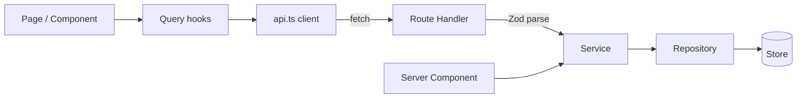

# Back Office

A commerce admin built with **Next.js 14 (App Router)**, **React 18** and **TypeScript**. It manages products, categories and discount campaigns through a REST API with a layered architecture, runtime validation, and server components.

The goal of this repo is architecture, not feature count: each domain has one complete slice you can read top to bottom.

## Stack

| Concern | Choice |
| --- | --- |
| Framework | Next.js 14 App Router (Route Handlers + Server Components) |
| Language | TypeScript, strict mode |
| Validation | Zod, shared by the API and the forms |
| Server state | TanStack Query v5 |
| Forms | React Hook Form + `zodResolver` |
| Styling | Tailwind CSS |
| Tests | Vitest |
| CI | GitHub Actions: lint, typecheck, test, build |

## Getting started

```bash
npm install
npm run dev        # http://localhost:3000
npm test           # unit tests
npm run build      # production build
```

No database or env vars needed. Data lives in memory and is seeded on boot, so it resets when the server restarts.

## Architecture

```
src/
├── app/                      Routing only: pages and thin route handlers
│   ├── api/                  HTTP layer: parse → call service → respond
│   ├── products/ categories/ campaigns/   Client pages
│   └── page.tsx              Server Component dashboard (calls services directly)
├── features/                 One folder per domain
│   └── <domain>/
│       ├── schema.ts         Zod schemas + inferred types (single source of truth)
│       ├── repository.ts     Data access only
│       ├── service.ts        Business rules
│       ├── api.ts            Typed browser client for this domain
│       ├── hooks.ts          TanStack Query hooks
│       └── components/       Domain UI (forms)
├── components/               Shared UI kit and layout
├── lib/                      errors, http helpers, api-client, in-memory db
└── providers/
```



**Why it's laid out this way**

- **Route handlers stay thin.** They validate input, call a service, and shape the response. Errors thrown anywhere become a consistent JSON envelope via `withErrorHandling`.
- **Business rules live in services**, not in routes or components. For example, a category that still has products can't be deleted, and a fixed discount can't exceed the cheapest product in a campaign.
- **Repositories hide storage.** Swapping the in-memory store for Prisma or Drizzle means rewriting three `repository.ts` files. Nothing else changes.
- **One Zod schema per domain** validates API requests and drives the form validation, so client and server can't drift apart.
- **The dashboard is a Server Component** that calls services directly, with no HTTP hop. The interactive pages use TanStack Query.

## API

Success: `{ "data": ..., "meta"?: ... }`. Failure: `{ "error": { "code", "message", "details"? } }`.

| Method | Endpoint | Notes |
| --- | --- | --- |
| GET | `/api/products` | `?page=&limit=&search=&categoryId=` returns `meta` with totals |
| POST | `/api/products` | 201. Category must exist |
| GET / PATCH / DELETE | `/api/products/:id` | PATCH accepts partial bodies |
| GET / POST | `/api/categories` | Slug generated; duplicate names return 409 |
| GET / PATCH / DELETE | `/api/categories/:id` | Delete returns 409 while products use it |
| GET / POST | `/api/campaigns` | Status (`scheduled` / `active` / `ended`) is computed from dates |
| GET / DELETE | `/api/campaigns/:id` | |

Status codes: `201` created, `204` deleted, `400` business rule, `404` not found, `409` conflict, `422` validation.

```bash
curl -X POST localhost:3000/api/categories \
  -H 'content-type: application/json' \
  -d '{"name":"Mice","description":"Wireless and wired"}'
```

## Scope

Built in full: products CRUD (API + UI), categories CRUD (API; list, create and delete in the UI), campaigns (create, list, delete).

Good next steps:

- [ ] Swap repositories for Prisma + Postgres
- [ ] Auth (Auth.js) and role-based access on mutating routes
- [ ] Campaign edit and pause, with price calculation for storefronts
- [ ] Optimistic updates on delete
- [ ] Playwright end-to-end tests
